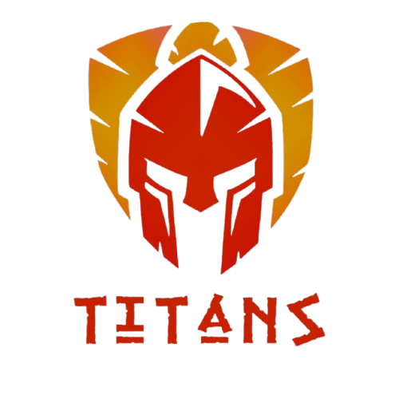

# Seguidor de Linha

  

---

## Sobre

Repositório destinado à documentação dos robôs seguidores de linha da Equipe Titans: Hammer-S, Besourineo e Azzip. O primeiro robô da equipe, o Sucrilho, está na seção de projetos descontinuados.

## Código de controle

O firmware dos robôs fica em um repositório separado: [team-titans-unb/codigoSeguidor](https://github.com/team-titans-unb/codigoSeguidor).

## Licença

Este projeto é distribuído sob a licença [GNU GPL v3](LICENSE).

---

## Histórico de Versões

| Versão | Descrição | Autor(es) | Data de Produção | Revisor(es) |
| :----: | --------- | --------- | :--------------: | :--------------: | 
| `1.0` | Modelagem inicial do readme | [Felipe das Neves](https://github.com/FelipeFreire-gf) | 02/03/2026 | ✓ |
| `1.1` | Robôs atuais, link para o código de controle e licença GPL v3 | [Felipe das Neves](https://github.com/FelipeFreire-gf) | 29/10/2026 | — |
