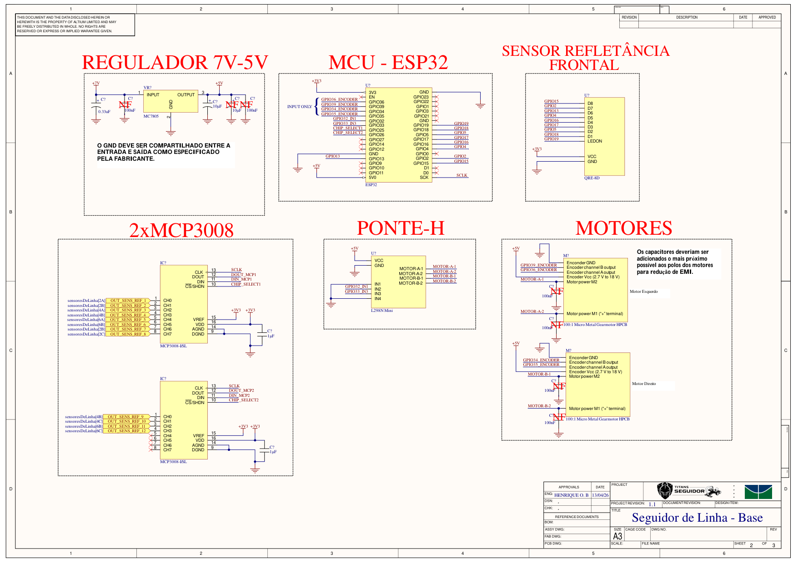
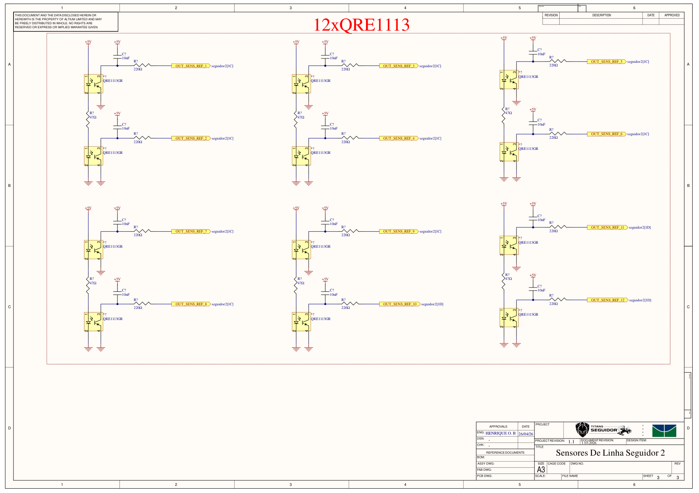

# Eletrônica — Azzip

Esta página descreve o esquemático do Azzip: a placa base com a ESP32, a ponte H e os motores, e a placa de sensores de linha com 12 QRE1113 lidos por dois conversores MCP3008.

---

## Sumário

- [Metadados do esquemático](#metadados-do-esquematico)
- [Visualização do esquemático](#visualizacao-do-esquematico)
- [Alimentação](#alimentacao)
- [ESP32: pinagem](#esp32-pinagem)
- [Motores, ponte H e encoders](#motores-ponte-h-e-encoders)
- [Sensor frontal QRE-8D](#sensor-frontal-qre-8d)
- [Placa de sensores: 12× QRE1113 e 2× MCP3008](#placa-de-sensores-12-qre1113-e-2-mcp3008)
- [Observações de projeto](#observacoes-de-projeto)
- [Referências bibliográficas](#referencias-bibliograficas)
- [Histórico de versões](#historico-de-versoes)

---

## Metadados do esquemático

| Campo | Folha 2 | Folha 3 |
| :--- | :--- | :--- |
| Título | Seguidor de Linha - Base | Sensores De Linha Seguidor 2 |
| Conteúdo | Regulador, ESP32, sensor frontal, 2× MCP3008, ponte H e motores | 12× QRE1113 |
| Revisão do projeto | 1.1 | 1.1 |
| Data | 13/04/2026 | 26/04/2026 |
| Autor | Henrique O. B. | Henrique O. B. |
| Ferramenta / formato | Altium, folha A3 | Altium, folha A3 |

!!! tip "Arquivos"
    O PDF do esquemático está em [`dados/esquematico-azzip.pdf`](dados/esquematico-azzip.pdf). Ele contém as folhas 2 e 3 de 3 do projeto.

---

## Visualização do esquemático

{ width="900" }

<b>Figura 1:</b> Placa base: regulador 7 V → 5 V, ESP32, sensor frontal, 2× MCP3008, ponte H e motores

{ width="900" }

<b>Figura 2:</b> Placa de sensores de linha com 12 QRE1113

---

## Alimentação

| Rede | Origem | Alimenta |
| :--- | :--- | :--- |
| **+7 V** | Bateria | Entrada do regulador MC7805 |
| **+5 V** | Saída do MC7805 | Pino **5V0** da ESP32, VCC da ponte H (motores), Vcc dos encoders e a placa de 12 QRE1113 |
| **+3,3 V** | Regulador da própria placa da ESP32 (pino **3V3**) | Sensor frontal QRE-8D e os dois MCP3008 (VDD e VREF) |
| **GND** | Comum | Todos os módulos |

**Capacitores do regulador:**

| Posição | Capacitor | Situação |
| :--- | :--- | :--- |
| Entrada | 0,33 µF eletrolítico | Montado |
| Entrada | 100 nF | NF (não montado) |
| Saída | 10 µF eletrolítico | Montado |
| Saída | 10 µF eletrolítico e 100 nF | NF (não montados) |

!!! note "Nota da folha"
    O GND deve ser compartilhado entre a entrada e a saída do regulador, como especificado pelo fabricante.

---

## ESP32: pinagem

| GPIO | Rede no esquemático | Ligado a |
| :--- | :--- | :--- |
| 36 | `GPIO36_ENCODER` | Encoder esquerdo, canal A (somente entrada) |
| 39 | `GPIO39_ENCODER` | Encoder esquerdo, canal B (somente entrada) |
| 35 | `GPIO35_ENCODER` | Encoder direito, canal A (somente entrada) |
| 34 | `GPIO34_ENCODER` | Encoder direito, canal B (somente entrada) |
| 32 | `GPIO32_IN1` | IN1 da ponte H (motor A, esquerdo) |
| 33 | `GPIO33_IN3` | IN3 da ponte H (motor B, direito) |
| 25 | `CHIP_SELECT1` | CS do MCP3008 nº 1 |
| 26 | `CHIP_SELECT2` | CS do MCP3008 nº 2 |
| SCK | `SCLK` | CLK dos dois MCP3008 |
| 19 | `GPIO19` | LEDON do sensor frontal |
| 18 | `GPIO18` | D1 do sensor frontal |
| 5 | `GPIO5` | D2 do sensor frontal |
| 17 | `GPIO17` | D3 do sensor frontal |
| 16 | `GPIO16` | D4 do sensor frontal |
| 4 | `GPIO4` | D5 do sensor frontal |
| 13 | `GPIO13` | D6 do sensor frontal |
| 2 | `GPIO2` | D7 do sensor frontal |
| 15 | `GPIO15` | D8 do sensor frontal |

**Pinos sem ligação:** EN, GPIO0, GPIO1, GPIO3, GPIO9, GPIO10, GPIO11, GPIO12, GPIO14, GPIO21, GPIO22, GPIO23, GPIO27, D0 e D1.

!!! info "GPIOs somente entrada"
    Os GPIOs 34, 35, 36 e 39 da ESP32 não têm saída nem resistor de pull-up interno. Por isso foram reservados para os encoders, que só precisam ser lidos.

---

## Motores, ponte H e encoders

| Item | Componente |
| :--- | :--- |
| Ponte H | Módulo **L298N Mini**, VCC em +5 V |
| Motores | 2× Pololu **100:1 Micro Metal Gearmotor HPCB** com encoder |
| Encoders | Alimentados em +5 V (faixa aceita: 2,7 V a 18 V) |

| Motor | Ponte H | Controle (ESP32) | Encoder A | Encoder B |
| :--- | :--- | :--- | :--- | :--- |
| Esquerdo | MOTOR-A-1 / MOTOR-A-2 | IN1 = GPIO32, IN2 = GND | GPIO36 | GPIO39 |
| Direito | MOTOR-B-1 / MOTOR-B-2 | IN3 = GPIO33, IN4 = GND | GPIO35 | GPIO34 |

Cada terminal dos motores tem um capacitor de 100 nF para o GND, marcado como NF (não montado).

!!! note "Nota da folha"
    Os capacitores devem ficar o mais próximo possível dos polos dos motores, para reduzir a interferência eletromagnética (EMI).

---

## Sensor frontal QRE-8D

Barra com 8 sensores de reflectância e saídas digitais **D1 a D8**, alimentada em **+3,3 V**. O pino **LEDON** (GPIO19) liga e desliga os emissores infravermelhos. A ligação de cada saída está na tabela da [pinagem da ESP32](#esp32-pinagem).

---

## Placa de sensores: 12× QRE1113 e 2× MCP3008

### Sensores QRE1113

A placa tem **12 sensores QRE1113GR**, montados em pares. Em cada par:

- **Emissores:** os dois LEDs infravermelhos ficam em série, do +5 V para o GND, com um resistor de **47 Ω**.
- **Saída:** o coletor de cada fototransistor tem um capacitor de **10 nF** para o +5 V e sai por um resistor de **220 Ω** para a rede `OUT_SENS_REF_n`.

### Conversores MCP3008

Os dois MCP3008 (ADC de 10 bits e 8 canais, interface SPI) são alimentados em +3,3 V, com VREF também em +3,3 V e um capacitor de desacoplamento de 1 µF cada.

| MCP3008 | CS (ESP32) | Canais usados | Sensores |
| :--- | :--- | :--- | :--- |
| Nº 1 | GPIO25 (`CHIP_SELECT1`) | CH0 a CH7 | `OUT_SENS_REF_1` a `OUT_SENS_REF_8` |
| Nº 2 | GPIO26 (`CHIP_SELECT2`) | CH0 a CH3 | `OUT_SENS_REF_9` a `OUT_SENS_REF_12` |

No MCP3008 nº 2, os canais CH4 a CH7 ficam sem ligação.

---

## Observações de projeto

Pontos encontrados na revisão do esquemático, para conferir antes de produzir a placa:

1. **SPI no pino SCK da ESP32:** o `SCLK` dos MCP3008 está no pino **SCK**. Nas placas de desenvolvimento ESP32 (WROOM), os pinos SCK, D0 e D1 são os GPIOs 6, 7 e 8, ligados à memória flash interna, e não podem ser usados. Como a ESP32 roteia o SPI para qualquer GPIO, dá para usar pinos livres, por exemplo **GPIO14 (SCLK)**, **GPIO27 (DIN/MOSI)** e **GPIO23 (DOUT/MISO)**.
2. **DIN e DOUT dos MCP3008 sem ligação:** as redes `DIN_MCP1`, `DIN_MCP2`, `DOUT_MCP1` e `DOUT_MCP2` não chegam à ESP32. No barramento SPI, os dois DIN se ligam juntos ao MOSI e os dois DOUT juntos ao MISO; cada chip é escolhido pelo seu CS.
3. **Circuito dos QRE1113 é do tipo RC:** o capacitor de 10 nF com o resistor de 220 Ω na saída é o circuito usado em barras de leitura por tempo de descarga (como a QTR-RC da Pololu). Esse tipo de leitura exige um GPIO que carregue o capacitor e depois meça o tempo de descarga; um canal de ADC não faz isso. Sem um resistor de pull-up no coletor, o MCP3008 lê sempre perto de 0. Para leitura analógica, o circuito usual tem um pull-up do coletor para a alimentação, como na QTR-A da Pololu.
4. **Saída de 5 V em ADC de 3,3 V:** os sensores ficam em +5 V e os MCP3008 em +3,3 V. As entradas do MCP3008 não devem passar de VDD + 0,6 V. Se for colocado um pull-up, ele deve ir para o +3,3 V, ou os MCP3008 devem passar para +5 V com divisores de tensão no DOUT para a ESP32.
5. **Motores alimentados pelo 7805:** a ponte H tira os +5 V do MC7805, que fornece cerca de 1 A. Na partida ou com o motor travado, os dois motores HPCB podem passar desse valor, e o regulador desliga ou derruba a ESP32. Além disso, o 7805 precisa de cerca de 2 V acima da saída, então 7 V na entrada é o mínimo. Uma opção é ligar o VCC da ponte H direto na bateria.
6. **Motores em um sentido só:** IN2 e IN4 estão no GND, então cada motor só gira para frente e não dá para frear invertendo o sentido. Ligar IN2 e IN4 a GPIOs livres permite ré e frenagem ativa.
7. **Pinos de boot no sensor frontal:** os GPIOs 2, 5 e 15 (D7, D2 e D8 do sensor frontal) definem o modo de boot da ESP32. Se o sensor forçar um nível nesses pinos na energização, a gravação ou a inicialização pode falhar.
8. **Capacitores NF:** os capacitores de 100 nF dos motores e parte dos capacitores do regulador estão marcados como não montados. Vale montar os dos motores, conforme a nota da própria folha.

---

## Referências bibliográficas

> [1] Espressif Systems. **ESP32 Series Datasheet** e **ESP32 Technical Reference Manual**: pinos somente entrada, pinos de boot, memória flash e matriz de GPIO.

> [2] Microchip. **MCP3004/3008 Datasheet**: ADC de 10 bits com interface SPI.

> [3] onsemi. **QRE1113 Datasheet**: sensor reflexivo infravermelho.

> [4] Pololu. **QTR Reflectance Sensors**: versões analógica (A) e por tempo de descarga (RC).

> [5] Pololu. **Micro Metal Gearmotors**: corrente de partida e de travamento das versões HPCB.

> [6] STMicroelectronics / Texas Instruments. **L78xx / LM7805 Datasheet**: regulador linear de 5 V.

---

## Histórico de Versões

| Versão | Descrição | Autor(es) | Data de Produção | Revisor(es) |
| :----: | --------- | --------- | :--------------: | :--------------: |
| `1.0` | Modelagem inicial do readme | [Felipe das Neves](https://github.com/FelipeFreire-gf) | 02/03/2026 | ✓ |
| `1.1` | Esquemático da placa base e da placa de sensores, pinagem e observações de projeto | [Felipe das Neves](https://github.com/FelipeFreire-gf) | 29/10/2026 | — |
