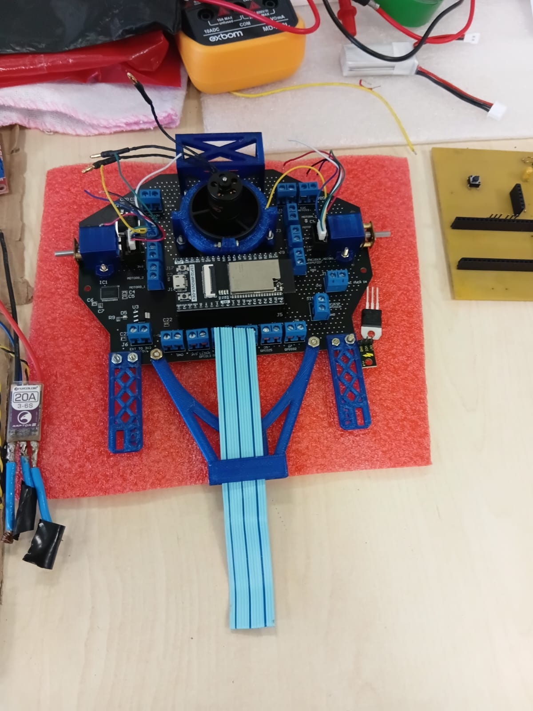

# Azzip

Seguidor de linha com **ESP32**, em montagem e testes. A placa base leva a ESP32, o driver dos motores e o regulador de 5 V. À frente fica uma placa com **12 sensores QRE1113**, lidos por dois conversores **MCP3008** (o esquemático prevê também uma barra frontal QRE-8D ligada direto na ESP32). No centro do chassi há uma **turbina com motor brushless** dentro de um duto impresso, acionada por um ESC.

{ width="600" }

<b>Figura 1:</b> Azzip em montagem: placa base com a ESP32, turbina central, micromotores nas laterais e suportes impressos em 3D

---

## Componentes principais

| Função | Componente |
| :--- | :--- |
| Microcontrolador | ESP32 (placa de desenvolvimento ESP32-WROOM) |
| Sensores de linha | 12× QRE1113 + 2× MCP3008 (ADC de 10 bits, SPI) |
| Sensor frontal (previsto no esquemático) | Barra QRE-8D com 8 saídas digitais |
| Driver dos motores | Módulo L298N Mini |
| Motores | 2× Pololu 100:1 Micro Metal Gearmotor HPCB com encoder |
| Turbina | Motor brushless em duto impresso, com ESC Flycolor Raptor 5 de 20 A (3-6S) |
| Alimentação | Bateria de 7 V + regulador MC7805 para 5 V; 3,3 V do regulador da ESP32 |
| Estrutura | Placa base em PCB e suportes impressos em 3D |

## Divisão das páginas

- [Mecânica](mec.md): modelo 3D interativo do Fusion 360.
- [Eletrônica](eletr.md): esquemático da placa base e da placa de sensores, pinagem e observações de projeto.
- [Controle](contro.md) e [Software](soft.md): ainda sem conteúdo.

---

## Histórico de Versões

| Versão | Descrição | Autor(es) | Data de Produção | Revisor(es) |
| :----: | --------- | --------- | :--------------: | :--------------: |
| `1.0` | Criação da página do robô | [Felipe das Neves](https://github.com/FelipeFreire-gf) | 29/10/2026 | — |
