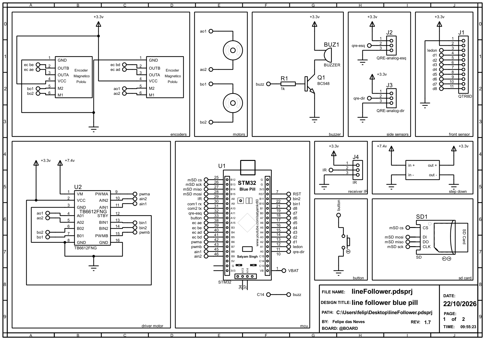
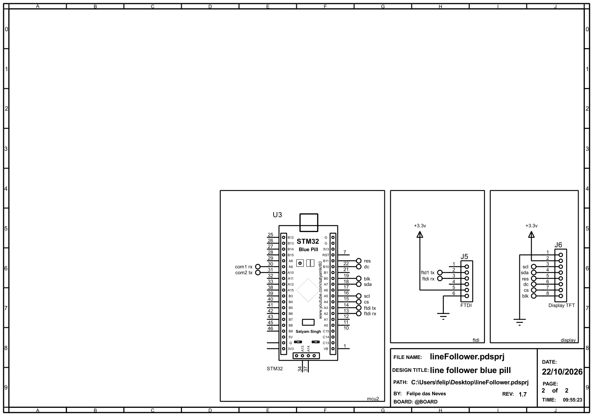

# Eletrônica — Hammer-S

Esta página descreve o esquemático das duas placas do Hammer-S, a pinagem das duas Blue Pill e a ligação entre elas.

---

## Sumário

- [Metadados do esquemático](#metadados-do-esquematico)
- [Visualização do esquemático](#visualizacao-do-esquematico)
- [Alimentação](#alimentacao)
- [STM1: pinagem](#stm1-pinagem)
- [STM2: pinagem e display](#stm2-pinagem-e-display)
- [Comunicação entre as placas](#comunicacao-entre-as-placas)
- [Observações de projeto](#observacoes-de-projeto)
- [Referências bibliográficas](#referencias-bibliograficas)
- [Histórico de versões](#historico-de-versoes)

---

## Metadados do esquemático

| Campo | Valor |
| :--- | :--- |
| Título | line follower blue pill |
| Arquivo | `lineFollower.pdsprj` (Proteus) |
| Folhas | 2: placa 1 (STM1) e placa 2 (STM2) |
| Revisão | 1.7 |
| Data | 22/10/2026 |
| Autor | Felipe das Neves |

!!! tip "Arquivos"
    Os PDFs do esquemático estão em [`dados/esquematico-hammer-s-placa1.pdf`](dados/esquematico-hammer-s-placa1.pdf) e [`dados/esquematico-hammer-s-placa2.pdf`](dados/esquematico-hammer-s-placa2.pdf).

---

## Visualização do esquemático

{ width="900" }

<b>Figura 1:</b> Placa 1 (STM1): encoders, motores, buzzer, sensores laterais, sensor frontal, driver, MCU, receptor IR, step-down, botão e micro SD

{ width="900" }

<b>Figura 2:</b> Placa 2 (STM2): MCU, FTDI e display TFT

---

## Alimentação

| Rede | Origem | Alimenta |
| :--- | :--- | :--- |
| **+7,4 V** | Bateria | VM do TB6612FNG (motores) e entrada do step-down |
| **+3,3 V** | Saída do step-down, no pino **3V3** das duas Blue Pill | Lógica do TB6612 (VCC e STBY), sensor frontal, QRE, encoders, receptor IR, buzzer, micro SD, FTDI e display |
| **GND** | Comum | Todos os módulos e as duas placas |

O pino **5V** das Blue Pill não é usado. Como todo o circuito trabalha em 3,3 V, nenhum sinal passa de 3,3 V nos pinos que não toleram 5 V (PA0–PA7, PB0, PB1 e PB5).

!!! warning "Módulo micro SD"
    Como não há trilho de 5 V, o módulo micro SD precisa ser do tipo **sem regulador** (ou ter um pino 3V3). Módulos com regulador AMS1117 precisam de 5 V no VCC.

---

## STM1: pinagem

{ width="900" }

<b>Figura 3:</b> Pinagem da STM1. Os números pequenos são os pinos do chip (LQFP48).

### Driver TB6612FNG e motores

| TB6612FNG | STM1 | Observação |
| :--- | :--- | :--- |
| PWMA | PB6 | TIM4_CH1, 20 kHz |
| PWMB | PB7 | TIM4_CH2, 20 kHz |
| AIN1 / AIN2 | PB8 / PB9 | Sentido do motor A |
| BIN1 / BIN2 | PB10 / PB11 | Sentido do motor B |
| STBY | 3,3 V | Driver sempre habilitado |
| AO1 / AO2 | Motor direito (M2 / M1) | Encoder "d" |
| BO1 / BO2 | Motor esquerdo (M2 / M1) | Encoder "e" |

### Encoders

Os dois encoders magnéticos Pololu são alimentados em 3,3 V e lidos em **modo encoder de hardware**: o timer conta os pulsos sozinho, sem gastar processamento.

| Encoder | Canal | STM1 | Timer |
| :--- | :---: | :---: | :--- |
| Esquerdo | A | PA15 | TIM2_CH1 (remapeado) |
| Esquerdo | B | PB3 | TIM2_CH2 (remapeado) |
| Direito | A | PB4 | TIM3_CH1 (remapeamento parcial) |
| Direito | B | PB5 | TIM3_CH2 (remapeamento parcial) |

### Sensores

**Sensor frontal (J1, `QTR8D` no esquemático):** conector de 11 pinos.

| J1 | Sinal | STM1 |
| :---: | :--- | :--- |
| 1 | GND | — |
| 2 | VCC | 3,3 V |
| 3 | LEDON | PA1 |
| 4 a 9 | D1 a D6 | PA2 a PA7 |
| 10, 11 | D7, D8 | PB0, PB1 |

**Sensores laterais (J2 e J3, `QRE-analog` no esquemático):** conectores de 3 pinos na ordem **3,3 V, sinal e GND**.

| Sensor | Conector | STM1 |
| :--- | :---: | :--- |
| QRE esquerdo | J2 | PA11 |
| QRE direito | J3 | PA0 (ADC1_IN0) |

**Receptor IR (J4):** conector de 3 pinos na ordem **3,3 V, sinal e GND**. O sinal vai no **PA8** (EXTI8, borda de descida).

### Micro SD, buzzer, botão e gravação

| Periférico | Sinal | STM1 |
| :--- | :--- | :--- |
| Micro SD | CS / SCK / MISO / MOSI | PB12 / PB13 / PB14 / PB15 (SPI2) |
| Buzzer | base do BC548 (via R1 1 kΩ) | PC14 |
| Botão | liga o pino ao GND quando pressionado | PA12 |
| ST-Link | SWDIO / SWCLK | PA13 / PA14 |
| LED da placa | — | PC13 |

O botão não tem resistor de pull-up próprio. O PA12 já tem o **R10** da Blue Pill ligado no 3,3 V, então o pino fica em nível alto solto e em nível baixo com o botão pressionado. Também dá para ligar o pull-up interno.

---

## STM2: pinagem e display

{ width="900" }

<b>Figura 4:</b> Pinagem da STM2

### Display TFT IPS 240×240 (ST7789)

| J6 | Display | STM2 | Função |
| :---: | :--- | :--- | :--- |
| 1 | GND | GND | — |
| 2 | VCC | 3,3 V | — |
| 3 | SCL | PA5 | SPI1 SCK |
| 4 | SDA | PA7 | SPI1 MOSI |
| 5 | RES | PB11 | Reset do display |
| 6 | DC | PB10 | Dado/comando |
| 7 | CS | PA4 | Só se o módulo tiver esse pino |
| 8 | BLK | PB0 | Brilho por PWM (TIM3_CH3), ou direto no 3,3 V |

!!! info "Modo do SPI"
    A maioria dos módulos 240×240 de 1,3" não tem pino CS. Nesse caso, o SPI1 precisa estar no **modo 3** (CPOL High, CPHA 2 Edge). Com CS, use o modo 0. Como o display não devolve dados, o SPI1 pode ser configurado como *Transmit Only Master*, deixando o PA6 livre.

### Serial de depuração (FTDI)

| J5 | FTDI | STM2 | Função |
| :---: | :--- | :--- | :--- |
| 2 | TX | PA3 | USART2 RX |
| 3 | RX | PA2 | USART2 TX |
| 5 | VCC | 3,3 V | — |
| 6 | GND | GND | — |

Os pinos 1 e 4 do J5 ficam sem ligação.

---

## Comunicação entre as placas

As duas placas usam a **USART1** e se ligam com as linhas cruzadas:

| STM1 | STM2 |
| :--- | :--- |
| PA9 (TX) | PA10 (RX) |
| PA10 (RX) | PA9 (TX) |
| GND | GND |

As duas trabalham em 3,3 V, então não precisam de conversor de nível. O GND entre elas é obrigatório.

!!! warning "Rótulos no esquemático"
    Nas duas folhas, o PA9 tem o rótulo `com1 rx` e o PA10 tem `com2 tx`. Como rótulos com o mesmo nome ficam ligados, o esquemático liga PA9 com PA9 e PA10 com PA10, ou seja, TX com TX. Na montagem, as linhas precisam ser cruzadas como na tabela acima.

!!! note "Depuração da STM1"
    Com a USART1 ocupada pela STM2, a STM1 fica sem FTDI. Para depurar a STM1 há três caminhos: a STM2 repassa as mensagens no FTDI dela (USART2), o RTT pelo próprio ST-Link, ou as *Live Expressions* da STM32CubeIDE durante o debug.

---

## Observações de projeto

1. **UART entre as placas:** os rótulos `com1 rx` e `com2 tx` são iguais nas duas folhas, o que liga TX com TX (veja o aviso em [Comunicação entre as placas](#comunicacao-entre-as-placas)). Vale renomear para algo como `stm1 tx` e `stm2 tx` e cruzar as ligações.
2. **Rótulo do FTDI:** no J5 o pino 2 está como `ftd1 tx` (com o número 1), mas na STM2 o rótulo é `ftdi tx`. Com nomes diferentes, o Proteus não liga os dois. Corrija o rótulo para `ftdi tx`.
3. **QRE esquerdo no PA11:** os conectores laterais agora são analógicos, mas o **PA11 não tem canal de ADC**. Ele só lê o QRE esquerdo como digital. Para ler os dois como analógicos, o QRE esquerdo precisa ir para um pino com ADC. Na STM1 todos os pinos com ADC (PA0–PA7, PB0, PB1) já estão ocupados, então a troca exige remanejar outro sinal.
4. **Botão no PA12:** o PA12 também é o USB D+ da Blue Pill. Não use o USB da placa junto com o botão.
5. **3,3 V no FTDI:** o J5 liga o 3,3 V da STM2 ao pino 5 do conector. Se o adaptador também fornecer energia por esse pino, as duas fontes ficam em paralelo. Confira a ordem dos pinos do adaptador; no FTDI comum de 6 pinos (GND, CTS, VCC, TX, RX, DTR) o VCC é o pino 3.
6. **Alimentação das Blue Pill e do micro SD:** no esquemático, os pinos 3V3 e G das duas Blue Pill e a alimentação do módulo micro SD aparecem sem ligação com as redes de 3,3 V e GND. Na montagem, todos precisam ser ligados.
7. **Debug em Serial Wire:** PA15, PB3 e PB4 só ficam livres para os encoders com `SYS → Debug: Serial Wire` no CubeMX.
8. **Buzzer no PC14:** esse pino fornece no máximo cerca de 3 mA. O R1 de 1 kΩ dá uns 2,6 mA; um resistor de 2,2 kΩ dá mais folga.
9. **Ruído dos motores:** mantenha os fios dos encoders separados dos fios dos motores (ou trance cada par).

---

## Referências bibliográficas

> [1] STMicroelectronics. **STM32F103x8/xB Datasheet** e **RM0008 Reference Manual** — pinagem, funções alternativas, canais de ADC, remapeamento de timers e pinos tolerantes a 5 V.

> [2] Toshiba. **TB6612FNG Datasheet** — driver de motores DC.

> [3] Pololu. **QTR Reflectance Sensor Arrays** — barras de 8 sensores.

> [4] Sitronix. **ST7789 Datasheet** — controlador do display TFT 240×240.

---

## Histórico de Versões

| Versão | Descrição | Autor(es) | Data de Produção | Revisor(es) |
| :----: | --------- | --------- | :--------------: | :--------------: |
| `1.0` | Esquemático da STM1, pinagem das duas placas e comunicação | [Felipe das Neves](https://github.com/FelipeFreire-gf) | 29/10/2026 | — |
| `1.1` | Esquemático rev. 1.7 com as duas placas: botão no PA12, QRE analógicos, conectores do sensor frontal, FTDI e display | [Felipe das Neves](https://github.com/FelipeFreire-gf) | 29/10/2026 | — |
