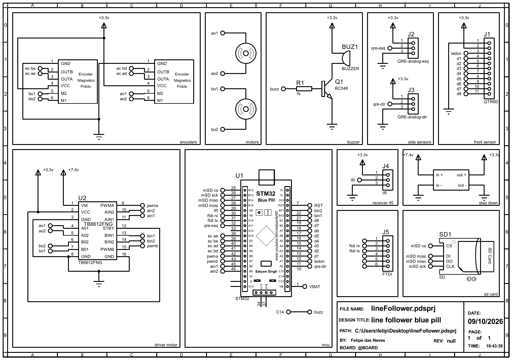
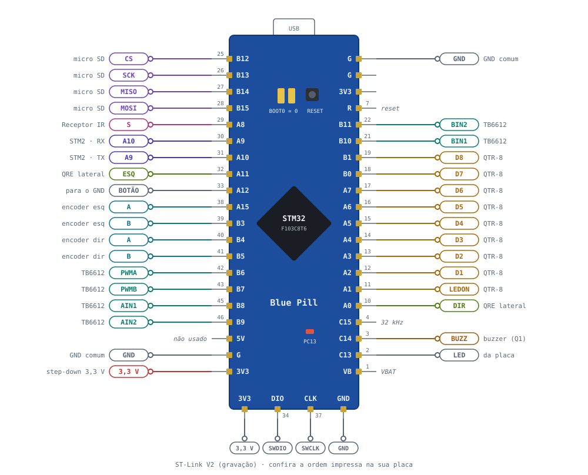
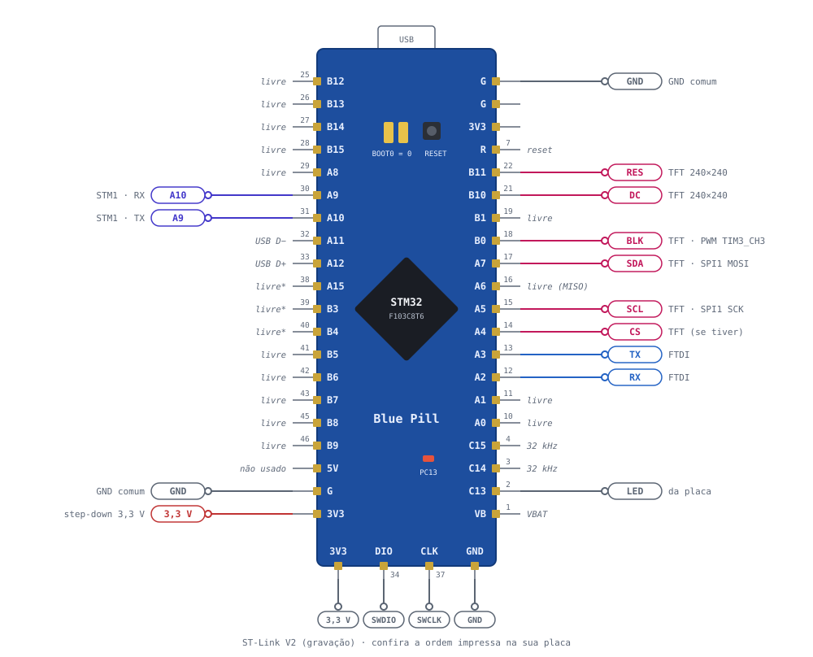

# Eletrônica — Hammer-S

Esta página descreve o esquemático da STM1, a pinagem das duas Blue Pill e a ligação entre elas.

---

## Sumário

- [Metadados do esquemático](#metadados-do-esquematico)
- [Visualização do esquemático](#visualizacao-do-esquematico)
- [Alimentação](#alimentacao)
- [STM1: pinagem](#stm1-pinagem)
- [STM2: pinagem e display](#stm2-pinagem-e-display)
- [Comunicação entre as placas](#comunicacao-entre-as-placas)
- [Observações de projeto](#observacoes-de-projeto)
- [Referências bibliográficas](#referencias-bibliograficas)
- [Histórico de versões](#historico-de-versoes)

---

## Metadados do esquemático

| Campo | Valor |
| :--- | :--- |
| Título | line follower blue pill |
| Arquivo | `lineFollower.pdsprj` (Proteus) |
| Folha | 1 de 1 |
| Data | 09/10/2026 |
| Autor | Felipe das Neves |
| Escopo | STM1 e periféricos (a STM2 e o display estão descritos nesta página) |

!!! tip "Arquivos"
    O PDF do esquemático está em [`dados/esquematico-stm1-lineFollower.pdf`](dados/esquematico-stm1-lineFollower.pdf).

---

## Visualização do esquemático

{ width="900" }

<b>Figura 1:</b> Esquemático da STM1 (encoders, motores, buzzer, sensores laterais, sensor frontal, driver, MCU, receptor IR, step-down, FTDI e micro SD)

---

## Alimentação

| Rede | Origem | Alimenta |
| :--- | :--- | :--- |
| **+7,4 V** | Bateria | VM do TB6612FNG (motores) e entrada do step-down |
| **+3,3 V** | Saída do step-down, no pino **3V3** das duas Blue Pill | Lógica do TB6612 (VCC e STBY), QTR-8RC, QRE, encoders, receptor IR, buzzer, micro SD e display |
| **GND** | Comum | Todos os módulos e as duas placas |

O pino **5V** das Blue Pill não é usado. Como todo o circuito trabalha em 3,3 V, nenhum sinal passa de 3,3 V nos pinos que não toleram 5 V (PA0–PA7, PB0, PB1 e PB5).

!!! warning "Módulo micro SD"
    Como não há trilho de 5 V, o módulo micro SD precisa ser do tipo **sem regulador** (ou ter um pino 3V3). Módulos com regulador AMS1117 precisam de 5 V no VCC.

---

## STM1: pinagem

{ width="900" }

<b>Figura 2:</b> Pinagem da STM1. Os números pequenos são os pinos do chip (LQFP48).

### Driver TB6612FNG e motores

| TB6612FNG | STM1 | Observação |
| :--- | :--- | :--- |
| PWMA | PB6 | TIM4_CH1, 20 kHz |
| PWMB | PB7 | TIM4_CH2, 20 kHz |
| AIN1 / AIN2 | PB8 / PB9 | Sentido do motor A |
| BIN1 / BIN2 | PB10 / PB11 | Sentido do motor B |
| STBY | 3,3 V | Driver sempre habilitado |
| AO1 / AO2 | Motor direito (M2 / M1) | Encoder "d" |
| BO1 / BO2 | Motor esquerdo (M2 / M1) | Encoder "e" |

### Encoders

Os dois encoders são lidos em **modo encoder de hardware**: o timer conta os pulsos sozinho, sem gastar processamento.

| Encoder | Canal | STM1 | Timer |
| :--- | :---: | :---: | :--- |
| Esquerdo | A | PA15 | TIM2_CH1 (remapeado) |
| Esquerdo | B | PB3 | TIM2_CH2 (remapeado) |
| Direito | A | PB4 | TIM3_CH1 (remapeamento parcial) |
| Direito | B | PB5 | TIM3_CH2 (remapeamento parcial) |

### Sensores

| Sensor | Sinal | STM1 |
| :--- | :--- | :--- |
| QTR-8RC | D1 … D6 | PA2 … PA7 |
| QTR-8RC | D7, D8 | PB0, PB1 |
| QTR-8RC | LEDON | PA1 |
| QRE esquerdo | saída (lida como digital) | PA11 |
| QRE direito | saída (lida como digital) | PA0 |
| Receptor IR | S | PA8 (EXTI8, borda de descida) |

### Micro SD, buzzer e gravação

| Periférico | Sinal | STM1 |
| :--- | :--- | :--- |
| Micro SD | CS / SCK / MISO / MOSI | PB12 / PB13 / PB14 / PB15 (SPI2) |
| Buzzer | base do BC548 (via R1 1 kΩ) | PC14 |
| ST-Link | SWDIO / SWCLK | PA13 / PA14 |
| LED da placa | — | PC13 |

---

## STM2: pinagem e display

{ width="900" }

<b>Figura 3:</b> Pinagem da STM2

### Display TFT IPS 240×240 (ST7789)

| Display | STM2 | Função |
| :--- | :--- | :--- |
| GND | GND | — |
| VCC | 3,3 V | — |
| SCL | PA5 | SPI1 SCK |
| SDA | PA7 | SPI1 MOSI |
| RES | PB11 | Reset do display |
| DC | PB10 | Dado/comando |
| BLK | PB0 | Brilho por PWM (TIM3_CH3), ou direto no 3,3 V |
| CS | PA4 | Só se o módulo tiver esse pino |

!!! info "Modo do SPI"
    A maioria dos módulos 240×240 de 1,3" não tem pino CS. Nesse caso, o SPI1 precisa estar no **modo 3** (CPOL High, CPHA 2 Edge). Com CS, use o modo 0. Como o display não devolve dados, o SPI1 pode ser configurado como *Transmit Only Master*, deixando o PA6 livre.

### Serial de depuração

| FTDI | STM2 | Função |
| :--- | :--- | :--- |
| RX | PA2 | USART2 TX |
| TX | PA3 | USART2 RX |
| GND | GND | VCC do FTDI não é ligado |

---

## Comunicação entre as placas

As duas placas usam a **USART1** e se ligam com as linhas cruzadas:

| STM1 | STM2 |
| :--- | :--- |
| PA9 (TX) | PA10 (RX) |
| PA10 (RX) | PA9 (TX) |
| GND | GND |

As duas trabalham em 3,3 V, então não precisam de conversor de nível. O GND entre elas é obrigatório.

!!! note "Depuração da STM1"
    Com a USART1 ocupada pela STM2, a STM1 fica sem FTDI. Para depurar a STM1 há três caminhos: a STM2 repassa as mensagens no FTDI dela (USART2), o RTT pelo próprio ST-Link, ou as *Live Expressions* da STM32CubeIDE durante o debug.

---

## Observações de projeto

1. **Debug em Serial Wire:** PA15, PB3 e PB4 só ficam livres para os encoders com `SYS → Debug: Serial Wire` no CubeMX.
2. **PA11 e PA12:** também são o USB da Blue Pill. Não use o USB da placa ao mesmo tempo. O PA12 tem o resistor R10 ligado no 3,3 V e fica em nível alto durante o reset.
3. **Buzzer no PC14:** esse pino fornece no máximo cerca de 3 mA. O R1 de 1 kΩ dá uns 2,6 mA; um resistor de 2,2 kΩ dá mais folga.
4. **Conector do FTDI (J5):** no esquema só os pinos 2 e 3 estão ligados. É preciso ligar também o **GND** e conferir a ordem do adaptador: no FTDI comum de 6 pinos, os pinos 2 e 3 são CTS e VCC.
5. **Conectores J2, J3 e J4:** no esquema a ordem é 3,3 V, sinal e GND. Confira se bate com os módulos; no receptor IR KY-022, por exemplo, o VCC costuma ficar no meio.
6. **Ruído dos motores:** mantenha os fios dos encoders separados dos fios dos motores (ou trance cada par).

---

## Referências bibliográficas

> [1] STMicroelectronics. **STM32F103x8/xB Datasheet** e **RM0008 Reference Manual** — pinagem, funções alternativas, remapeamento de timers e pinos tolerantes a 5 V.

> [2] Toshiba. **TB6612FNG Datasheet** — driver de motores DC.

> [3] Pololu. **QTR-8RC Reflectance Sensor Array** — funcionamento por tempo de descarga.

> [4] Sitronix. **ST7789 Datasheet** — controlador do display TFT 240×240.

---

## Histórico de Versões

| Versão | Descrição | Autor(es) | Data de Produção | Revisor(es) |
| :----: | --------- | --------- | :--------------: | :--------------: |
| `1.0` | Esquemático da STM1, pinagem das duas placas e comunicação | [Felipe das Neves](https://github.com/FelipeFreire-gf) | 29/10/2026 | — |
