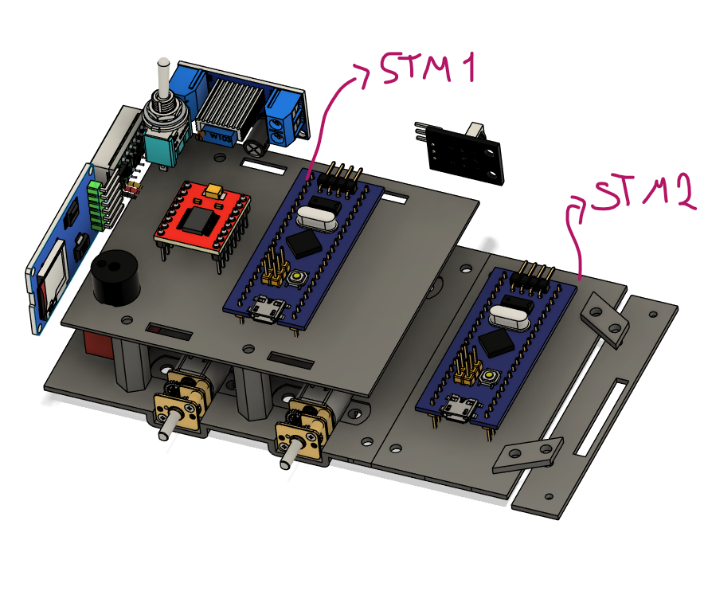

# Hammer-S

Seguidor de linha com **duas STM32 Blue Pill**. A **STM1** cuida de tudo que é tempo real: leitura do sensor frontal, controle dos motores, encoders, sensores laterais, micro SD, controle remoto IR e buzzer. A **STM2** fica livre para a interface com o usuário e controla um **display TFT IPS 240×240**. As duas placas conversam por UART.

{ width="600" }

  
<b>Figura 1:</b> Modelo 3D do robô, com a posição das duas Blue Pill

---

## Componentes principais

| Função | Componente | Placa |
| :--- | :--- | :---: |
| Microcontroladores | 2× STM32 Blue Pill (STM32F103C8T6) | STM1 e STM2 |
| Sensor frontal | Pololu QTR-8RC (8 sensores, leitura por tempo de descarga) | STM1 |
| Sensores laterais | 2× QRE (lidos como digitais) | STM1 |
| Driver dos motores | TB6612FNG | STM1 |
| Motores | 2× micromotores com encoder magnético Pololu | STM1 |
| Controle remoto | Receptor IR 38 kHz (protocolo NEC) | STM1 |
| Registro de dados | Módulo micro SD (SPI) | STM1 |
| Sinalização | Buzzer ativo com transistor BC548 | STM1 |
| Interface | Display TFT IPS 240×240 (ST7789, SPI) | STM2 |
| Alimentação | Bateria 7,4 V + step-down para 3,3 V | ambas |

## Divisão das páginas

- [Mecânica](mec.md): modelo 3D e estrutura.
- [Eletrônica](eletr.md): esquemático, pinagem das duas placas e ligação entre elas.
- [Controle](contro.md): responsabilidades de cada placa e comunicação.

---

## Histórico de Versões

| Versão | Descrição | Autor(es) | Data de Produção | Revisor(es) |
| :----: | --------- | --------- | :--------------: | :--------------: |
| `1.0` | Criação da página do robô | [Felipe das Neves](https://github.com/FelipeFreire-gf) | 29/10/2026 | — |
