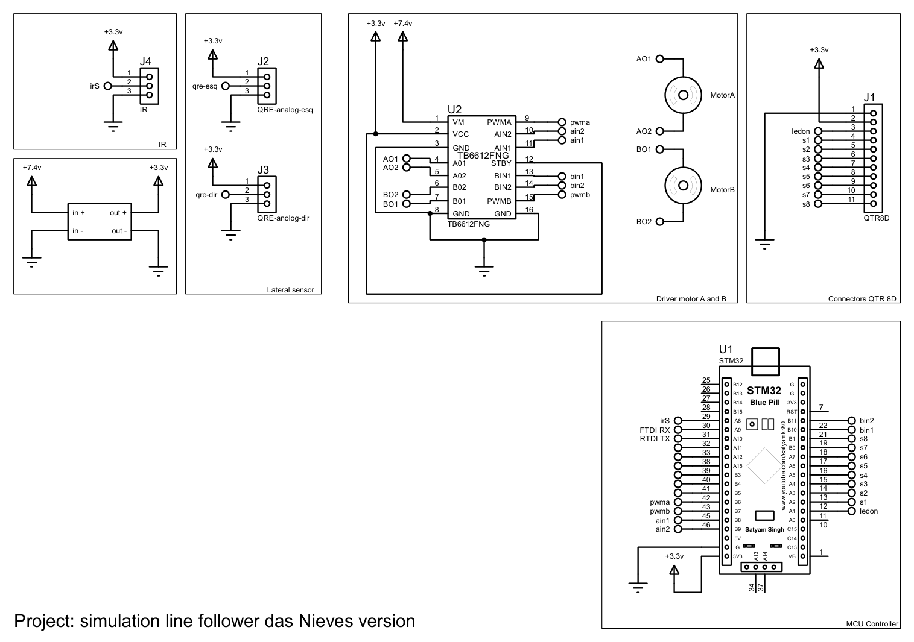
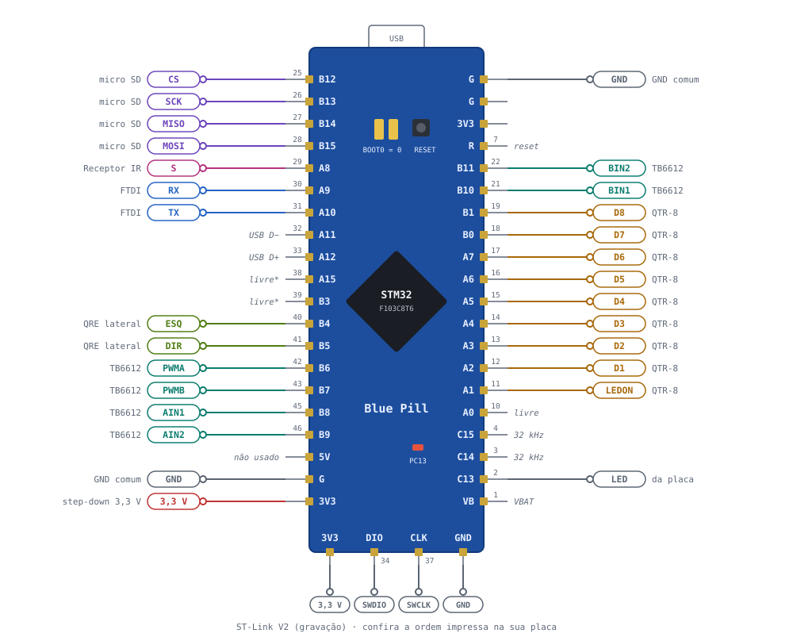

# Eletrônica — Besourineo

Esta página descreve o esquemático do Besourineo, a pinagem da Blue Pill e a configuração do STM32CubeMX usada pelo firmware.

---

## Sumário

- [Metadados do esquemático](#metadados-do-esquematico)
- [Visualização do esquemático](#visualizacao-do-esquematico)
- [Visualização da pinagem](#visualizacao-da-pinagem)
- [Ligações por módulo](#ligacoes-por-modulo)
- [Alimentação](#alimentacao)
- [Configuração no STM32CubeMX](#configuracao-no-stm32cubemx)
- [Observações de projeto](#observacoes-de-projeto)
- [Histórico de versões](#historico-de-versoes)

---

## Metadados do esquemático

| Campo | Valor |
| :--- | :--- |
| Título | simulation line follower das Nieves version |
| Arquivo | `dasNieves_no_simulation.pdsprj` (Proteus) |
| Folhas | 1 |
| Data de exportação | 29/10/2026 |
| Autor | Felipe das Neves |

!!! tip "Arquivos"
    O PDF do esquemático está em [`dados/esquematico-besourineo.pdf`](dados/esquematico-besourineo.pdf).

---

## Visualização do esquemático

{ width="900" }

<b>Figura 1:</b> Esquemático do Besourineo: receptor IR, step-down, sensores laterais, driver dos motores, sensor frontal e Blue Pill

### Conectores

| Conector | Módulo | Pinos |
| :--- | :--- | :--- |
| J1 (`QTR8D`) | Sensor frontal | 1 GND, 2 3,3 V, 3 LEDON, 4 a 11 = S1 a S8 |
| J2 (`QRE-analog-esq`) | QRE esquerdo | 1 3,3 V, 2 sinal, 3 GND |
| J3 (`QRE-analog-dir`) | QRE direito | 1 3,3 V, 2 sinal, 3 GND |
| J4 (`IR`) | Receptor IR | 1 3,3 V, 2 sinal (PA8), 3 GND |

---

## Visualização da pinagem

{ width="900" }

<b>Figura 2:</b> Pinagem da Blue Pill do Besourineo. Os números pequenos são os pinos do chip (LQFP48).

---

## Ligações por módulo

### Driver TB6612FNG

| TB6612FNG | Blue Pill | Observação |
| :--- | :--- | :--- |
| PWMA | PB6 | TIM4_CH1, 20 kHz |
| PWMB | PB7 | TIM4_CH2, 20 kHz |
| AIN1 / AIN2 | PB8 / PB9 | Motor A (esquerdo no firmware) |
| BIN1 / BIN2 | PB10 / PB11 | Motor B (direito no firmware) |
| STBY | 3,3 V | Driver sempre habilitado |
| VCC | 3,3 V | Lógica |
| VM | Bateria | Motores |

### Sensores

| Sensor | Sinal | Blue Pill |
| :--- | :--- | :--- |
| QTR-8RC | D1 … D6 | PA2 … PA7 |
| QTR-8RC | D7, D8 | PB0, PB1 |
| QTR-8RC | LEDON | PA1 |
| QRE esquerdo | saída (digital) | PB4 |
| QRE direito | saída (digital) | PB5 |
| Receptor IR | S | PA8 |

### Comunicação e armazenamento

| Periférico | Sinal | Blue Pill |
| :--- | :--- | :--- |
| FTDI | RX do FTDI / TX do FTDI | PA9 (USART1 TX) / PA10 (USART1 RX) |
| Micro SD | CS / SCK / MISO / MOSI | PB12 / PB13 / PB14 / PB15 |
| ST-Link | SWDIO / SWCLK | PA13 / PA14 |
| LED da placa | — | PC13 (pisca a cada 0,5 s) |

---

## Alimentação

- **Bateria:** vai no VM do TB6612FNG e na entrada do step-down.
- **3,3 V:** alimenta a lógica do TB6612, o QTR-8RC, os QRE, o receptor IR e o micro SD.
- **GND:** comum entre bateria, driver, Blue Pill, FTDI e módulos.
- **FTDI:** ligue só TX, RX e GND. O VCC do adaptador fica desligado quando a placa está na bateria.

!!! warning "Pinos que não toleram 5 V"
    PA0–PA7, PB0, PB1 e PB5 não toleram 5 V. Alimente o QTR-8RC e os QRE em 3,3 V.

---

## Configuração no STM32CubeMX

O firmware depende dos **User Labels** abaixo, escritos exatamente assim (em minúsculas).

| Pino | Modo | User Label |
| :--- | :--- | :--- |
| PA1 | GPIO_Output | `ledon` |
| PA2 … PA7, PB0, PB1 | GPIO_Input, No pull | `qtr1` … `qtr8` |
| PB4 | GPIO_Input, No pull | `qre_esq` |
| PB5 | GPIO_Input, No pull | `qre_dir` |
| PB8 / PB9 | GPIO_Output | `ain1` / `ain2` |
| PB10 / PB11 | GPIO_Output | `bin1` / `bin2` |
| PB12 | GPIO_Output, nível alto | `sd_cs` |
| PC13 | GPIO_Output | `led_placa` |
| PA8 | GPIO_EXTI8, borda de descida, pull-up | `ir` |

| Bloco | Configuração |
| :--- | :--- |
| RCC | HSE: Crystal/Ceramic Resonator |
| SYS | Debug: Serial Wire |
| Clock | HSE 8 MHz → PLL ×9 → 72 MHz; APB1 /2, APB2 /1 |
| TIM4 | Internal Clock; CH1 e CH2 em PWM Generation; Prescaler 0; Counter Period 3599 |
| USART1 | Asynchronous, 115200, 8N1 |
| SPI2 | Full-Duplex Master, NSS por software, Prescaler 128 |
| NVIC | EXTI line[9:5] habilitada |
| Project Manager | Toolchain / IDE: **STM32CubeIDE** |

---

## Observações de projeto

1. **Motor esquerdo no canal A:** o firmware considera o motor A como o esquerdo. Se os motores estiverem trocados no TB6612, as curvas saem invertidas.
2. **USB da placa:** PA11 e PA12 ficam livres e não devem ser usados enquanto o USB da Blue Pill estiver em uso.
3. **Receptor IR:** mantenha um capacitor de 100 nF entre VCC e GND perto do receptor, por causa do ruído dos motores.
4. **QRE sem ligação no esquemático:** os conectores J2 e J3 têm os rótulos `qre-esq` e `qre-dir`, mas esses rótulos não aparecem na Blue Pill. O firmware lê os QRE no **PB4** e no **PB5**; falta colocar os rótulos nesses pinos.
5. **Micro SD fora do esquemático:** o firmware usa o micro SD no SPI2 (PB12 a PB15), mas o módulo não está desenhado. Os pinos PB12 a PB15 aparecem sem ligação.
6. **FTDI sem conector:** o PA9 e o PA10 têm os rótulos `FTDI RX` e `RTDI TX`, mas não há conector para o FTDI no desenho. O rótulo `RTDI TX` também tem um erro de digitação (deveria ser `FTDI TX`).
7. **Rótulo do QRE direito:** o J3 está escrito `QRE-anolog-dir`. É só o nome do componente, sem efeito nas ligações.

---

## Histórico de Versões

| Versão | Descrição | Autor(es) | Data de Produção | Revisor(es) |
| :----: | --------- | --------- | :--------------: | :--------------: |
| `1.0` | Pinagem e configuração do CubeMX | [Felipe das Neves](https://github.com/FelipeFreire-gf) | 29/10/2026 | — |
| `1.1` | Esquemático do Proteus e tabela de conectores | [Felipe das Neves](https://github.com/FelipeFreire-gf) | 29/10/2026 | — |
